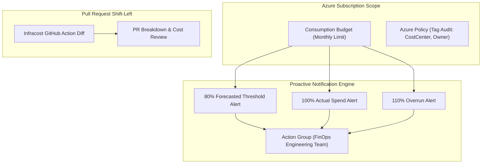

# 💳 Azure FinOps Guardrails (Terraform)

[](https://www.terraform.io/)
[](https://registry.terraform.io/providers/hashicorp/azurerm/latest)
[](https://github.com/sanjiivsingh/azure-finops-guardrails/actions)
[](https://github.com/sanjiivsingh/azure-finops-guardrails)
[](https://opensource.org/licenses/MIT)

> **Reference Architecture · Statically Validated**  
> Enterprise FinOps guardrails as Terraform code: subscription consumption budgets, multi-tier forecast/actual spend alerts, Azure Policy tag enforcement, and Infracost CI shift-left cost automation. Detailed verification logs are documented in [docs/EVIDENCE.md](docs/EVIDENCE.md) and architectural patterns in [docs/ARCHITECTURE.md](docs/ARCHITECTURE.md).

---

## 🏛️ Architecture Overview



---

## 🌟 Key Features

- **Multi-Stage Budget Alerts**: Proactively alerts on 80% forecasted spend before overages happen, plus 100% and 110% actual spend thresholds.
- **Tagging Governance as Code**: Azure Policy definition auditing missing `CostCenter`, `Owner`, `Environment`, and `Project` tags.
- **Shift-Left FinOps**: Infracost workflow demonstrating automated pull-request cost impact estimation.
- **Zero Running Infrastructure Cost**: Built entirely on Azure native control plane resources ($0.00/month).

---

## 🚀 Quickstart

### Prerequisites
- Terraform `>= 1.9.0`
- Azure CLI `>= 2.60.0`
- Azure Subscription Contributor or Cost Management Contributor role

### Deployment
```bash
git clone https://github.com/sanjiivsingh/azure-finops-guardrails.git
cd azure-finops-guardrails

terraform init
terraform fmt -check
terraform validate
terraform plan -out=tfplan
terraform apply tfplan
```

---

## 💰 Cost Profile & Teardown

- **Monthly Cost**: $0.00 / month (Azure Cost Management budgets and Policy evaluations incur no charge).
- **Teardown**:
  ```bash
  terraform destroy -auto-approve
  ```

---

## 👨‍💻 Author & Cloud Consultant

**Sanjeev Singh**  
Senior Azure Cloud Architect & DevSecOps Platform Engineer  
* 🌐 **Portfolio**: [sanjeevsingh.oneps.in](https://sanjeevsingh.oneps.in)  
* 💼 **LinkedIn**: [linkedin.com/in/sanjiivsingh](https://linkedin.com/in/sanjiivsingh)  
* 🐙 **GitHub**: [github.com/sanjiivsingh](https://github.com/sanjiivsingh)

---

## 📄 License
This project is open-source under the [MIT License](LICENSE).
